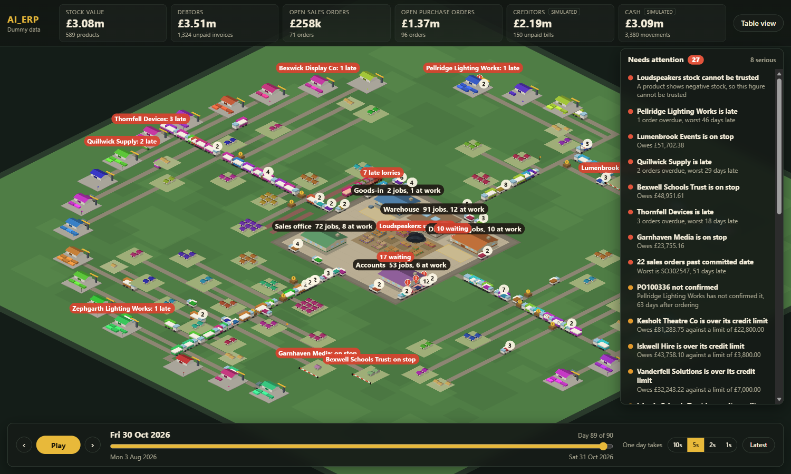

# AI_ERP

Proof of concept: an ERP you play like a strategy game.

The business is rendered as a living settlement generated from data. Purchase orders are lorries on the road, stock is stockpiles in the yard, customers are villages, and late or broken things are visibly stuck. Orders, deliveries, counts, shipments and invoice payments are actions you take in the world.

This is a proof of concept. It is not a production ERP and it never writes to a live system.

## Documents

- [Project Initiation Document](docs/PID.md): why, what, scope, stages, risks.
- [Context](docs/CONTEXT.md): the concept, domain, design rules and guardrails. Read this before writing any code, human or AI agent.
- [Data mapping](docs/DATA-MAPPING.md): every Fabric table and column the world needs, with gaps. Section 11 records what the mirror was found to hold.
- [Build plan](docs/BUILD-PLAN.md): stack, sim people, world generation, architecture, data connections, milestones.

## Status

Stage 1 (a read-only living world on dummy data) is built. One thing is left before it is signed off: showing it to three people and checking each can name the late suppliers within 30 seconds. See the [build plan](docs/BUILD-PLAN.md#11-milestones) and [HANDOFF.md](HANDOFF.md).



## Run it

Needs Node 22 or later.

```
npm install
npm run dev      # API on 127.0.0.1:5191, world on http://localhost:5190
npm run check    # lint, typecheck, tests, build
```

In the world:

- Drag to pan, scroll to zoom.
- Click anything (a lorry, a stockpile, a worker, a building) to see the records behind it.
- Click a figure in the top bar to see the records that add up to it.
- Space plays the days back. Left and right arrows step one day.

All data in this repository is synthetic. Regenerate it with `npm run generate -w @ai-erp/dummygen`.

## Real data

The world can also run on a look-back built from Fabric, read-only. The data stays on your machine in `data/real/`, which is gitignored. See [ingest/README.md](ingest/README.md).

```
cd ingest && python -m aierp_ingest.snapshot --start 2026-10-01
cd .. && npm run dev:real
```
